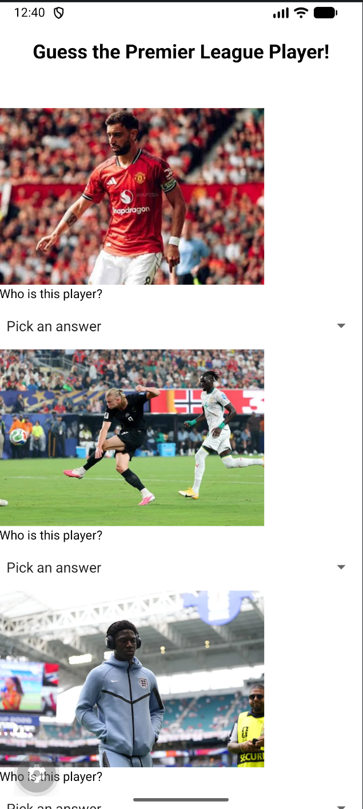
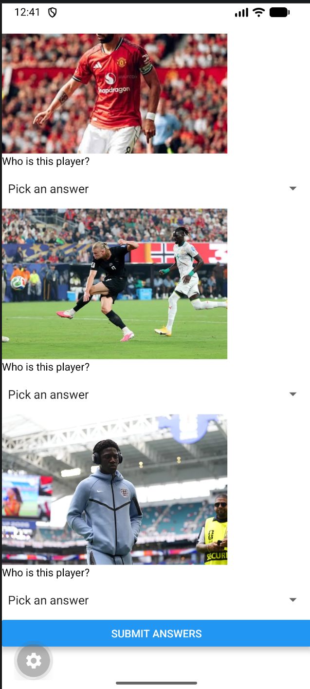

# Guess the Premier League Player!

A simple quiz app made with React Native and Expo. The app shows photos of Premier League players, and the user has to pick the correct name for each one. After answering all the questions, the user presses Submit to see how many they got right.

# Features Highlight

- **3 quiz questions**, each with a photo of a Premier League player
- **Online images** loaded using the `Image` component with a `uri` link
- **Picker dropdowns** (from `@react-native-picker/picker`) with 3 answer options per question, plus a "Pick an answer" default option
- **useState** to save the user's answer for each question
- **Submit Answers button** that checks the answers and shows an `Alert` with the score (e.g. "You got 2 out of 3 correct!")
- **ScrollView** so the user can scroll through all the questions
- **Styled title** using inline styles (centered, bigger and bold)

# ScreenShots of App

Screenshots:  

# Demo Video

Demo Video Link:  
(IN POLITEMALL SUBMISSION)